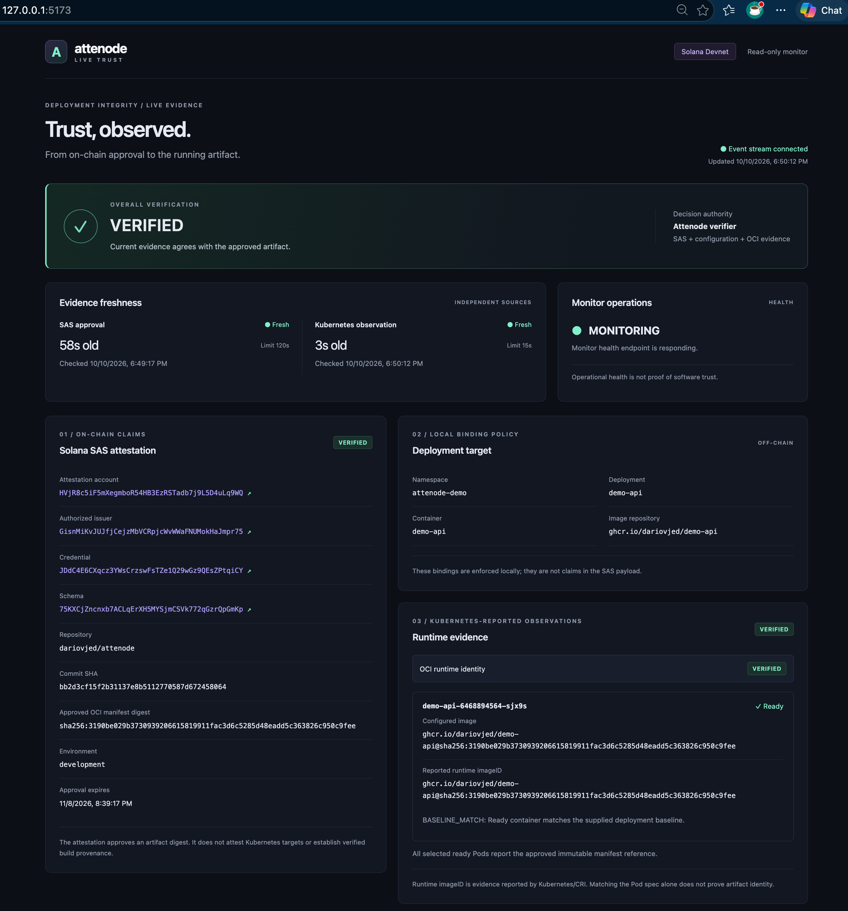
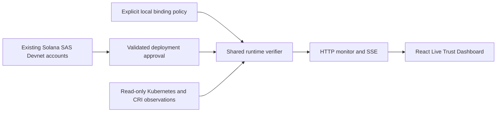
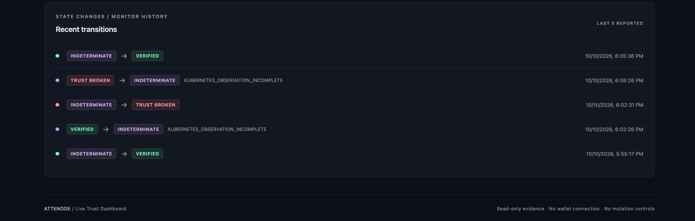

# Attenode

Verifiable identity for production software.

The **Live Trust Dashboard** is Attenode's working MVP. It continuously checks whether a running Kubernetes workload matches a deployment approved through Solana Attestation Service (SAS). Its React interface connects a validated Devnet attestation, an immutable OCI image reference, and live Kubernetes runtime observations into one read-only trust view.

Built for the **Colosseum Solana Hackathon**, the working MVP demonstrates **VERIFIED → TRUST_BROKEN → VERIFIED**: an operator changes the deployed image, Attenode detects the drift, and restoring the approved image restores trust. Rolling updates can correctly produce **INDETERMINATE** while observations are ambiguous.



*The live dashboard presents VERIFIED status alongside SAS approval, Kubernetes runtime evidence and independent source freshness.*

## Working architecture



- **Solana:** validate the Credential → Schema → Attestation account chain with `finalized` commitment, including ownership, discriminators, PDA/nonce, issuer authorization, schema layout, exact payload and expiration.
- **Runtime:** bind the decoded on-chain artifact digest to an explicitly configured image repository and Kubernetes target; compare current Pod configuration and supported runtime image identity.
- **Monitor:** observe Kubernetes every 5 seconds and renew SAS initially and every 60 seconds. Reuse only validated, unexpired SAS evidence within an explicit freshness window; recompute trust against current Kubernetes observations.
- **Dashboard:** present backend decisions, independent source freshness, operational health, on-chain claims, local policy, runtime observations and recent transitions through SSE.

The CLI, monitor and dashboard are implemented. Monitoring detects and reports drift; it does not enforce policy or roll back workloads.

## Run the dashboard

Prerequisites: Node.js/npm, repository dependencies, an authorized kubeconfig/context, the existing Devnet attestation and the demo workload. The persistent transport regression and live monitor were validated on Node.js 24.10.0; this is not a guarantee for every Node/SDK combination.

From the repository root, install locked dependencies if needed:

```bash
npm ci --ignore-scripts --no-audit --no-fund
npm ci --prefix apps/dashboard --ignore-scripts --no-audit --no-fund
```

Starting the monitor performs real read-only Devnet and Kubernetes requests. Use only an authorized configuration; never share kubeconfig contents or credentials.

```bash
export ATTENODE_KUBECONFIG="/path/to/authorized/kubeconfig"
export ATTENODE_CONTEXT="kind-attenode"
export ATTENODE_NAMESPACE="attenode-demo"
export ATTENODE_DEPLOYMENT="demo-api"
export ATTENODE_CONTAINER="demo-api"
export ATTENODE_IMAGE_REPOSITORY="ghcr.io/dariovjed/demo-api"
npm run monitor:start
```

In a second terminal:

```bash
npm run dashboard:start
```

Open **http://127.0.0.1:5173**. The backend binds to `127.0.0.1:3001`; Vite proxies `/api`, including SSE, to it. The frontend does not access kubeconfig, wallets or private keys.

Component guides: [dashboard](apps/dashboard/README.md), [monitor](apps/monitor/README.md), [runtime verifier](src/runtime/README.md), and [demo workload and drift procedure](demo/README.md).

## Read-only SAS + Kubernetes verification

For an independent, one-shot check using the environment above:

```bash
npm run --silent verify:k8s -- \
  --sas \
  --kubeconfig "$ATTENODE_KUBECONFIG" \
  --context "$ATTENODE_CONTEXT" \
  --namespace "$ATTENODE_NAMESPACE" \
  --deployment "$ATTENODE_DEPLOYMENT" \
  --container "$ATTENODE_CONTAINER" \
  --image-repository "$ATTENODE_IMAGE_REPOSITORY"
```

Append `--json` for structured output. Exit codes: `0` VERIFIED, `2` TRUST_BROKEN, `3` INDETERMINATE, `1` configuration/execution failure. SAS mode rejects manual approval overrides; the existing manual baseline mode remains available.

The current SAS policy supports this demo-api binding only:

| Source | Value |
| --- | --- |
| Attested repository | `dariovjed/attenode` |
| Attested commit | `bb2d3cf15f2b31137e8b5112770587d672458064` |
| Attested environment | `development` |
| Attested artifact digest | `sha256:3190be029b3730939206615819911fac3d6c5285d48eadd5c363826c950c9fee` |
| Provenance provider | Empty string; no verified build provenance |
| Local image repository | `ghcr.io/dariovjed/demo-api` |
| Local Kubernetes target | `attenode-demo` / Deployment `demo-api` / container `demo-api` |

Existing public Devnet accounts:

- [Attestation](https://explorer.solana.com/address/HVjR8c5iF5mXegmboR54HB3EzRSTadb7j9L5D4uLq9WQ?cluster=devnet): `HVjR8c5iF5mXegmboR54HB3EzRSTadb7j9L5D4uLq9WQ`
- Credential: `JDdC4E6CXqcz3YWsCrzswFsTZe1Q29wGz9QEsZPtqiCY`
- Schema: `75KXCjZncnxb7ACLqErXH5MYSjmCSVk772qGzrQpGmKp`
- Trusted issuer: `GisnMiKvJUJfjCejzMbVCRpjcWvWWaFNUMokHaJmpr75`

The unchanged `DeploymentAttestationV1` payload contains `repository`, `commitSha`, `artifactDigest`, `environment`, `provenanceProvider` and `deployedAt`. It does **not** attest the image repository, namespace, Deployment or container. Those are local binding policy. `deployedAt` is an attestation payload timestamp, not independent proof of a Kubernetes rollout.

## Demonstrated behavior and validation

The operator manually validated the MVP against real Solana Devnet and a local kind cluster: approved immutable GHCR image → VERIFIED; intentional image change → TRUST_BROKEN; restoration → VERIFIED. INDETERMINATE appeared during rolling updates. The persistent monitor refreshed both sources, and the dashboard received live SSE updates. The monitor-only RPC transport fix was also validated in a persistent Node process, including two successful scheduled SAS renewals.



*The transition history records image drift and recovery, including INDETERMINATE observations during rolling updates.*

These are **manual live results**, separate from automated offline regression tests. Reported checks passed for TypeScript, the dashboard production build, monitor/dashboard tests and RPC transport regression. To repeat the relevant automated checks without live services:

```bash
npm run check
npm run dashboard:check
npm run dashboard:build
npm run test:dashboard
npm run test:monitor
npm run test:monitor:sas-comparison
npm run test:monitor:rpc-transport
npm run test:sas:reader
npm run test:sas:k8s
npm run test:k8s
npm run test:k8s:output
npm run test:runtime
npm run test:verification:diagnostics
```

Use the named suites: the root `npm test` is still a placeholder, not an aggregate test runner. Offline fixtures and mocks do not establish live trust. The controlled SAS fixture has a synthetic digest and must never approve the real demo image.

## Security guarantees and limits

- Monitoring and verification do not load a Solana wallet, submit transactions or mutate Kubernetes. Separate Devnet creation scripts exist; they are not part of dashboard startup.
- VERIFIED requires current, valid SAS approval, unambiguous ready Kubernetes observations, matching immutable configuration and supported canonical `repository@sha256:…` runtime identity evidence.
- A reliable configured-image mismatch can produce overall TRUST_BROKEN even when OCI runtime identity remains INDETERMINATE. Missing, unready, mixed-rollout or failed observations remain conservative.
- Docker image/config IDs, bare CRI hashes and registry manifest digests are different identity domains. A mutable tag or matching Pod spec alone does not prove runtime artifact identity.
- Kubernetes API/node/CRI reports and the configured Solana RPC endpoint are trusted observation sources. This is not independent proof of execution, cryptographically verified build provenance or a production security guarantee.
- Polling cannot instantly discover on-chain changes. Cached SAS approval is bounded by freshness and expiration, and is invalidated when rejection is observed. A correct local clock is required.
- Health describes monitor operation, not software trust. Historical reports are diagnostic-only; history is in memory. Local APIs have restrictive loopback/CORS settings but no authentication.

For transport diagnostics and timeout recovery, see the [monitor troubleshooting guide](apps/monitor/README.md#troubleshooting). The static dashboard build requires a same-origin `/api` proxy; production hosting and automatic enforcement are outside this MVP.
